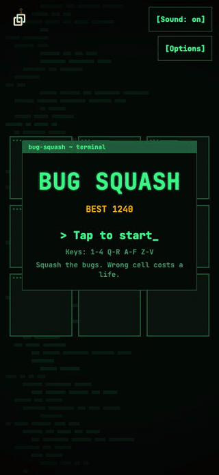
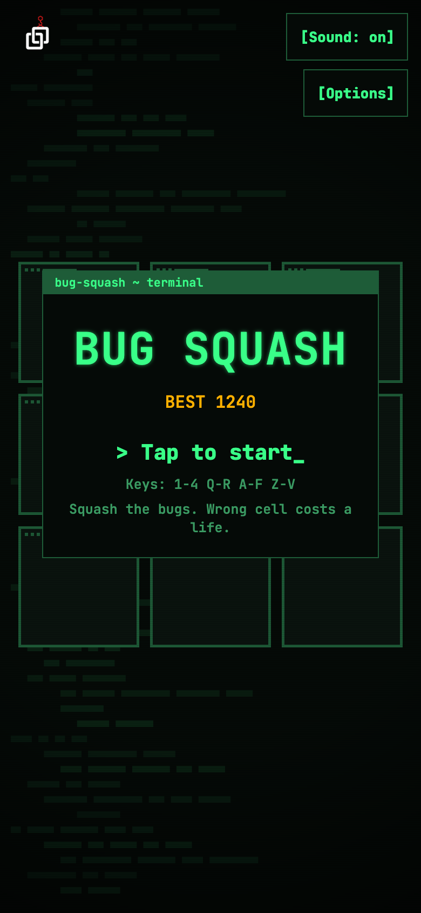
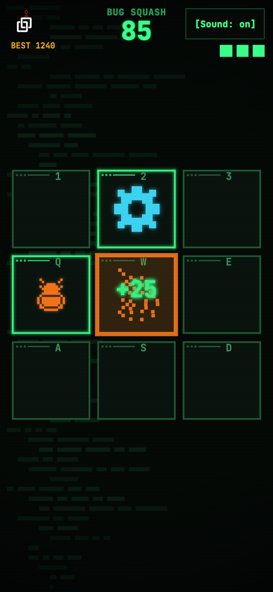
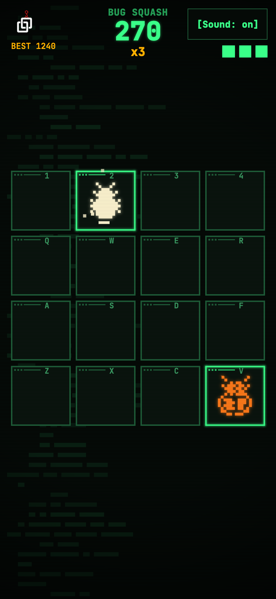
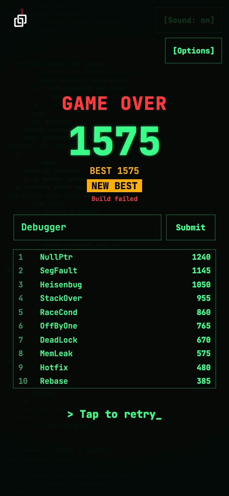
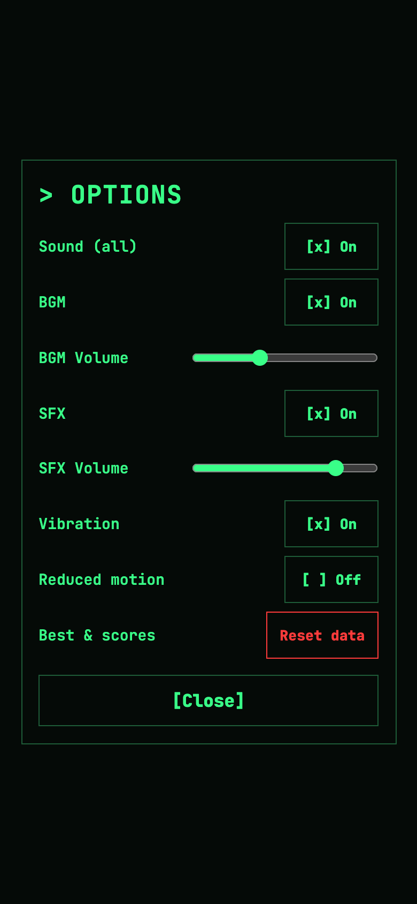

# Bug Squash

[](https://github.com/devcol-main/Bug-Squash/actions/workflows/ci.yml)

**English** · [한국어](README.ko.md)

A whack-a-mole game for people who write code. Bugs pop up in the cells of a retro terminal; squash them before they escape, leave the working features alone, and survive as the board scales up. Built with TypeScript, Canvas 2D and WebAudio — no game engine, no external CDN, and not a single audio file: every sound and the soundtrack are synthesized in code.

<p align="center">
  
</p>

<sub>The clip uses a fixed seed and a sped-up difficulty curve so it fits in about 20 seconds (the board expands at 10s instead of 45s, and hard and golden bugs show up earlier and more often). Everything you see is what the real game draws.</sub>

| Title | 3x3 board | 4x4 board | Game over | Options |
|---|---|---|---|---|
|  |  |  |  |  |

<sub>The screenshots also use a fixed seed and boosted spawn settings (denser spawns, more hard and golden bugs, the board expanding at 15 s), so the score on the game-over screen is higher than a normal run of the same length. The leaderboard names are sample data.</sub>

## How to play

| Input | Action |
|---|---|
| Tap / click a cell | Squash whatever is in it |
| `1 2 3 4` / `Q W E R` / `A S D F` / `Z X C V` | The cells of the 4x4 board, by keyboard position |
| `1 2 3` / `Q W E` / `A S D` | The cells of the 3x3 board |
| `Space` | Start / retry |
| `M` | Mute |

Keys are matched by their physical position, so the layout works the same with a Korean IME or a non-QWERTY layout. After your first key press, each cell shows its key in the corner.

### Rules

- You start with **3 lives**.
- Squash a **bug** before it hides again. If one escapes, you lose a life.
- A **hard bug** (bigger, orange, double shell) takes two hits. The first hit cracks it.
- A **golden bug** is a bonus: +50 points (times your combo), and a life back if you are missing one. Missing it costs no life, but it does reset your combo.
- A **feature** (the cyan gear) is working code. Tapping it costs a life.
- Tapping an **empty cell** also costs a life. Tapping outside the board is free.
- At **45 seconds** the board scales up from 3x3 to 4x4.

### Scoring

| Object | Points |
|---|---|
| Bug | 10 |
| Hard bug | 25 |
| Golden bug | 50 |

Points are multiplied by your combo (consecutive squashes): **x2** from 5, **x3** from 10, **x4** from 20. Missing any bug (golden included), tapping a feature or tapping an empty cell resets the combo. Score never goes down — mistakes cost lives and combo, not points.

### Difficulty curve

Difficulty depends on play time (paused time does not count) and, for the on-screen limit, on the board size. Every value has a floor or a ceiling:

| | Start | Change | Limit (reached at about) |
|---|---|---|---|
| Time between spawns | 1.0 s | x0.985 per second | 0.35 s (69 s) |
| Time a bug stays up | 1.4 s | −0.012 s per second | 0.6 s (67 s) |
| Share of features | 10% | +0.3 points per second | 30% (67 s) |
| Objects on screen at once | 2 | 3 from 30 s; 4 on 4x4, 5 from 90 s | |

Hard bugs appear from 20 s (15% of bugs, and they stay up 1.3x longer). Golden bugs appear from 15 s (2% per spawn, one at a time, 0.7x the exposure). All of this lives in [`src/core/config.ts`](src/core/config.ts).

## Design notes

### From whack-a-mole to "debugging"

The game started from one sentence: whack-a-mole, but the moles are bugs. That gave the rest of the theme for free. The cells are slots where code runs, bugs are what you must catch, and **features** are working code you must not touch — the tension every developer knows from hotfixing in a hurry. The game-over screen does not say "you died"; it says **Build failed**.

### Every game gets its own identity

The first version reused the look and sound of its sibling game, [Stack Up](https://github.com/devcol-main/Arcade-Web): dark purple neon, a star field, a synth soundtrack. It worked, but it felt like a level pack, not a new game. So Bug Squash was rebuilt as a **retro terminal**:

- Near-black background with faint lines of "code" (drawn as bars, not text) scrolling up like terminal output, under a CRT overlay with scanlines and a vignette.
- Square, title-barred cells that look like terminal windows.
- Phosphor green for the UI, amber for bugs, orange for hard bugs, pale gold for golden bugs, cyan for features, red for errors.
- JetBrains Mono for every piece of text, including buttons written as `[Sound: on]` and checkboxes as `[x]`.
- Effects that belong to a terminal: squashed bugs dissolve into pixels, a feature tap tears the screen with a horizontal glitch instead of shaking it, `> SCALING UP_` types itself out, and game over is a CRT power-off.
- A chiptune soundtrack and terminal sounds instead of synth pads (see [Audio](#audio)).

### Drawing bugs without borrowing anyone's

The first pixel-art bugs were wide and flat with claws on the sides — they read as space-invader aliens. That is both the wrong message and a look owned by someone else. They were redrawn as **top-down beetles** following a few simple rules: taller than wide, a narrow head, a waist between thorax and abdomen, three legs per side pointing forward, sideways and back, no holes that could read as eyes, and an unbroken bottom row. Tests check the key ones on the sprite data — taller than wide, no eye-like holes, an unbroken bottom row — so a later edit cannot quietly drift back.

### Readable without color

Bugs and features differ in **shape**, not just color: a beetle silhouette versus a round gear with a hole. Hard bugs are slightly larger with a double shell; a cracked hard bug is missing pixels. You can play it in grayscale.

### Harder, but fair

Two rules were added after the first playable version:

- **Empty cells cost a life.** Without it, the best strategy was to mash every cell. Now a tap has to mean something. There is deliberately no grace period: a cell is empty the moment its bug is gone.
- **Keyboard play.** The left side of the keyboard maps to the board, so desktop players can use two hands. Two keys pressed together are two taps.

Fairness details: taps during the board expansion are ignored instead of counted as mistakes, the first frame after you come back to the tab cannot cost you a life, and after game over input is locked for 0.6 s so a frantic last tap does not skip the results screen.

### Accessibility

**Reduced motion** (from the OS setting or the options panel) turns off the screen glitch, the CRT flicker and the CRT power-off, halves the pixel debris, shows the `SCALING UP` banner at once, and swaps the board-expansion slide for a short crossfade. Dimmed text uses a color with about 5.7:1 contrast against the background, and the smallest labels (the rule hint, the key line, Build failed) have a 10 px floor.

## Technical notes

### Structure

```
src/
  core/     pure game logic: no DOM, Canvas, Audio or storage
  view/     Canvas rendering, sprites, VFX, layout
  audio/    WebAudio synthesis and the soundtrack scheduler
  input/    pointer and keyboard input, cell mapping, vibration
  ui/       screen flow, HTML HUD and overlays, options, records
  shared/   leaderboard and player profile (shared format with other DevCol games)
  main.ts   the game loop that wires them together
tests/      Vitest
```

### A deterministic core

`core/` takes `tap(cell)` and `update(dt)` and returns a list of events (caught, missed, feature tapped, board expanded, game over…). It has no idea a screen exists. Randomness comes from an injected seeded generator, so the same seed and the same inputs always produce the same game — the basis for a future daily challenge. Large time steps are split into small sub-steps, so a long frame cannot skip the 45-second expansion or let a bug expire without being judged. The view, the audio and the HUD all react to the same event list.

### Rendering

- **No `shadowBlur` per frame.** Every glowing thing — cells, bugs, text — is drawn once to an offscreen canvas when the size changes and then copied with `drawImage`. Separate sprite sets are built for the 3x3 and 4x4 boards so pixel art stays crisp, and static sprites are snapped to device pixels.
- **Pixel art as data.** Bugs and gears are small grids in code. The same grids drive the drawing, the size checks in tests and the dissolve effect (each pixel becomes a particle).
- **Pooled effects.** Particles, popups and flashes come from fixed-size pools, and the game loop avoids allocating objects per frame.
- **CRT overlay.** Scanlines are drawn in device pixels with alpha corrected per pixel ratio, so a 1.5x screen is not darker than a 2x one.
- **Device pixel ratio** is capped at 2 and re-detected when a window moves between monitors.

### Audio

All sound is generated at runtime with WebAudio:

- **Soundtrack:** an 8-bar chiptune loop at 150 BPM in A minor (Am–F–C–G, then Am–F–G–Am), with a pulse-wave lead built from `PeriodicWave` (12.5% and 25% duty, volume-matched), a triangle bass, and noise drums with a pitch-swept kick. It is scheduled with a look-ahead timer so it stays in time even when frames drop.
- **Effects:** a mechanical-keyboard click plus an 8-bit blip whose pitch rises with your combo, a stepped glitch for a cracked hard bug, a coin arpeggio for golden bugs, a terminal error bell for features, and a falling "power-off" whoosh with a mains hum on game over.
- Audio starts on the first user input (browser autoplay rules) and pauses when the tab is hidden. BGM and SFX have separate volumes.

### Input

Pointer Events handle mouse, touch and pen in one path; every `pointerdown` is one tap, per pointer, so two fingers on two cells are two taps. Screen coordinates are mapped to cells by a pure function that is tested for device pixel ratio, letterboxing and cell edges. Keyboard input uses `KeyboardEvent.code`, ignores auto-repeat and modifier shortcuts, and is off while you type a nickname.

### Storage and leaderboard

Everything is stored in `localStorage` behind `try/catch`, so the game still runs where storage is blocked. On devcol.net the Top 10 comes from the shared online leaderboard (`a.devcol.net/lb`, server in [devcol-analytics](https://github.com/devcol-main/devcol-analytics)); every score is also saved locally, and the game falls back to the local board with an "Offline" note when the server can't be reached. There is no login: the first submit gets a random owner token (`devcol.player.token`), used for Options → Online scores → Delete mine. The player ID is never sent, and offensive names are shown as `Player####`. Outside devcol.net it is local only (`npm run dev` with `?lb=http://localhost:8787/lb` talks to a local Worker). All of this sits behind the `LeaderboardService` interface. Each DevCol game keeps its own leaderboard and stats (for Bug Squash: bugs squashed, best combo and time survived), while a small shared player profile (one ID and nickname) lets a future dashboard rank players across games.

### Size

The production build is about **164 KB** including the font and logo (no audio files), checked against a 300 KB limit in CI.

## How it was built

Bug Squash was developed spec-first with a small agent pipeline (see [`CLAUDE.md`](CLAUDE.md) and [`docs/`](docs/)):

1. Each change starts as a written spec in [`docs/tasks/`](docs/tasks/) with a checklist of automated and manual checks.
2. The work is split into sub-tasks in a fixed order: core logic and tests, rendering, effects and audio, UI, then polish.
3. For each sub-task an implementer agent writes the code, a test-runner agent runs the type check and the test suite, and a reviewer agent reviews the diff against the spec. Rejected work goes back with the findings.
4. There are hard loop limits: three attempts per sub-task, and the work stops and asks a human after that. Every sub-task is logged in [`docs/pipeline-log.md`](docs/pipeline-log.md) with its attempt count and the review findings that sent it back, mistakes included.
5. Visual and audio checks that a test cannot make — feel, sound balance, real devices — are listed for a human at the end of every task.

The result is **487 automated tests** covering the game rules, difficulty curve, input mapping, layout, effects state, audio scheduling, storage and these media tools. CI runs the type check, the tests, a production build and a bundle check on pull requests to `main`.

## Development

Requires Node.js 24 (see [`.nvmrc`](.nvmrc)).

```bash
npm ci
npm run dev      # dev server
npm run check    # tsc --noEmit + Vitest
npm run build    # production build to dist/ (relative paths)
npm run media    # regenerate docs/media (needs Google Chrome and ffmpeg)
```

Check the bundle after a build with `bash scripts/verify-build.sh` (size limit 300 KB, no dev-only hooks in the bundle).

### Embedding in the site

```bash
npm run build
bash scripts/copy-to-site.sh
```

This copies `dist/` to `../devcol-site/devcol-build/docs/public/games/bug-squash/`, which the VitePress page embeds in an iframe.

### CI

[`.github/workflows/ci.yml`](.github/workflows/ci.yml) runs on pull requests and pushes to `main`: `npm ci`, `npm run check`, `npm run build`, then `scripts/verify-build.sh`.

## Roadmap

- A cross-game leaderboard dashboard for devcol.net
- A leaderboard server (the game already talks to an interface, not to `localStorage` directly)
- A daily challenge built on the seeded core

## License

- Code: [Apache License 2.0](LICENSE). See [`NOTICE`](NOTICE).
- Font: JetBrains Mono, SIL Open Font License 1.1, bundled with its license in `public/licenses/`.
- DevCol logo (`src/assets/`): owned by DevCol; not licensed for reuse under Apache-2.0 (see [`docs/assets.md`](docs/assets.md)).
- Screenshots and the GIF in `docs/media/` are captures of this game, made with `npm run media`.

Originally developed in [devcol-main/Arcade-Web](https://github.com/devcol-main/Arcade-Web).
